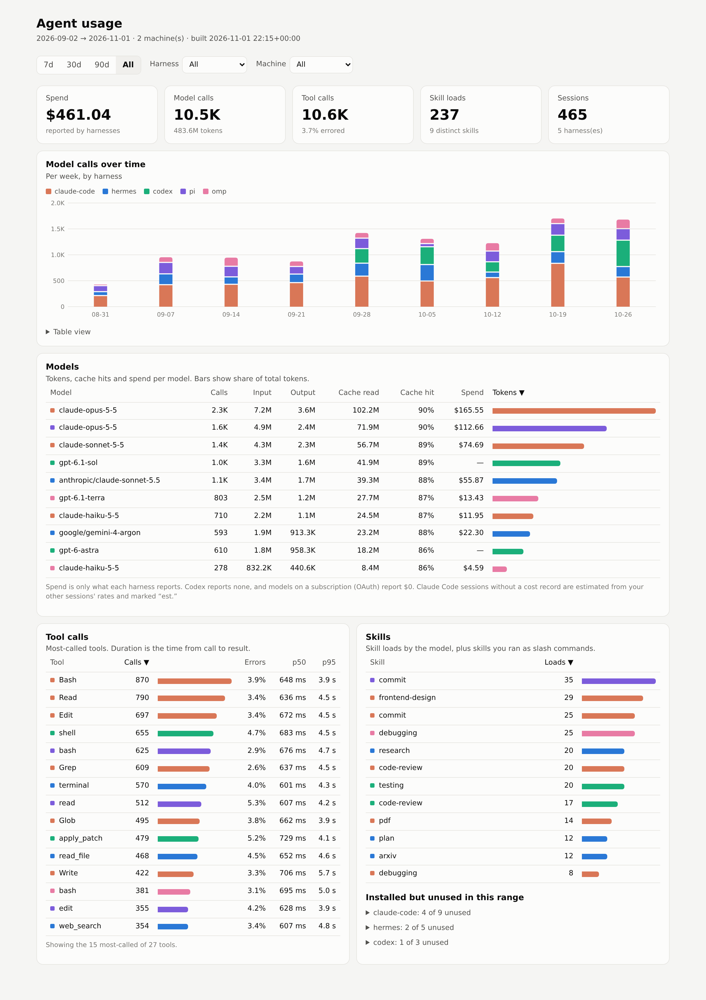

# agent-usage

Skills, tool calls and model usage across local coding agents, in one table and one page.

<picture>
  <source media="(prefers-color-scheme: dark)" srcset="docs/screenshots/dashboard-dark.png">
  
</picture>

<sub>Synthetic data from <code>scripts/demo-data</code>.</sub>

```sh
uv tool install git+https://github.com/acramatte/agent-usage   # or: uv tool install .
agent-usage agents      # which agents are on this machine, session files, ingested yes/no
agent-usage ingest      # transcripts -> events-<machine>.parquet (+ skills-<machine>.json)
agent-usage dashboard   # -> dashboard.html (self-contained) and open it
agent-usage sync --repo <user>/<dataset>   # optional, needs 'agent-usage[sync]'
```

Data lives in `$AGENT_USAGE_DATA`, else `$XDG_DATA_HOME/agent-usage`
(`~/.local/share/agent-usage`); override per command with `--data-dir`.
**Coming from the `uv run ingest.py` scripts:** move `data/*` there first (or pass
`--data-dir ./data`), otherwise sessions Claude Code has already pruned are lost.

Agents are discovered from a vendored copy of
[deja-vu](https://github.com/vshulcz/deja-vu)'s registry
(`agent_usage/registry/`, MIT, commit in `SOURCE`; refresh with
`scripts/update-registry`). Its store paths drive the adapters too, so env
overrides (`CLAUDE_CONFIG_DIR`, `CODEX_HOME`, `HERMES_HOME`, ...) and profiles
(`~/.hermes/profiles/*`, `~/.omp/profiles/*`) are read. Only the five harnesses
below have usage adapters; `agents` lists the rest as found/not found.

## Sources

| Harness | Read from | Model usage | Cost | Tools | Skills |
|---|---|---|---|---|---|
| Claude Code | `~/.claude/{projects,transcripts}/**/*.jsonl` (incl. subagents) | per API call, plus per-session totals of background models (title generation, ...) from `cost-state` | session `cost-state`, split by price weight; estimated when absent | `tool_use` / `tool_result` | `Skill` tool, slash commands matching an installed skill |
| Codex | `~/.codex/{sessions,archived_sessions}/**/rollout-*.jsonl` | `token_count` deltas | none | `function_call`, `custom_tool_call` | reads of `…/skills/<name>/SKILL.md` |
| pi | `~/.pi/agent/sessions/**/*.jsonl` | per message | reported per message | `toolCall` / `toolResult` | reads of `SKILL.md` |
| OMP | `~/.omp/agent/sessions/**/*.jsonl`, `~/.omp/profiles/*/agent/sessions` | per message, plus side-model `model_usage` records (e.g. `find`) | reported per call | `toolCall` / `toolResult`, timed from `tool_execution_start` | `skill://<name>` or `SKILL.md` reads |
| Hermes | `~/.hermes/state.db`, `~/.hermes/profiles/*/state.db` (read-only) | `session_model_usage` (per session × model × task) | actual, else estimated | `messages.tool_calls` | `skill_view` |

Hermes is read from its local database rather than Langfuse: same data, no API keys.

## Schema (`events-*.parquet`)

One row per event: `ts, machine, harness, session_id, project, event_type`
(`model_call | tool_call | skill | command`), `name` (model / tool / skill), `detail`,
`n` (call count; >1 only for Hermes aggregates; a Claude Code background-model total counts as 1), token columns, `cost_usd`, `cost_source`
(`reported | estimated`), `duration_ms`, `is_error`, `is_subagent`.

Re-running `ingest` replaces sessions still on disk and keeps the ones a harness has
since pruned (Claude Code deletes transcripts after ~30 days), so run it regularly.

## Multiple machines

Each machine writes its own `events-<hostname>.parquet`, and `dashboard` reads every
one in the data dir. To share them through a private
[Hugging Face dataset](https://huggingface.co/docs/hub/datasets):

```sh
uv tool install 'agent-usage[sync] @ git+https://github.com/acramatte/agent-usage'
hf auth login                              # once per machine, write token
export AGENT_USAGE_HF_REPO=<user>/<dataset>   # or pass --repo
agent-usage ingest && agent-usage sync && agent-usage dashboard   # on each machine
```

`sync` uploads this machine's `events-`/`skills-` files (creating the dataset,
private, if missing) and downloads every other machine's. It never overwrites this
machine's local files with the pushed copies, which can only be older; if they are
missing (a reinstall under the same hostname) it restores them, so the next
`ingest` keeps the sessions pruned since.

`sync` refuses a dataset that is public; pass `--allow-public` to override.

## Development

```sh
uv run pytest                     # adapters against tests/fixtures/home (synthetic, redacted)
scripts/compare-events a.parquet b.parquet   # counts and sums per harness / event type
scripts/demo-data /tmp/demo && uv run agent-usage dashboard --data-dir /tmp/demo   # README screenshots
```

The screenshots are full-page captures at 1280px wide, 2x, with
`document.documentElement.dataset.theme` set to `light` / `dark`, quantized to 256 colours.
